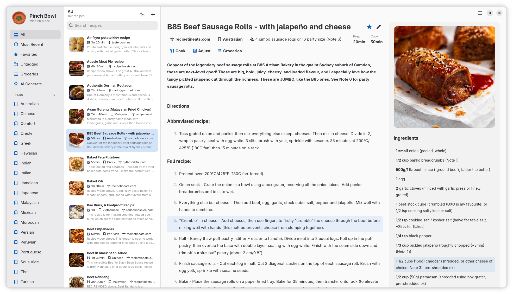
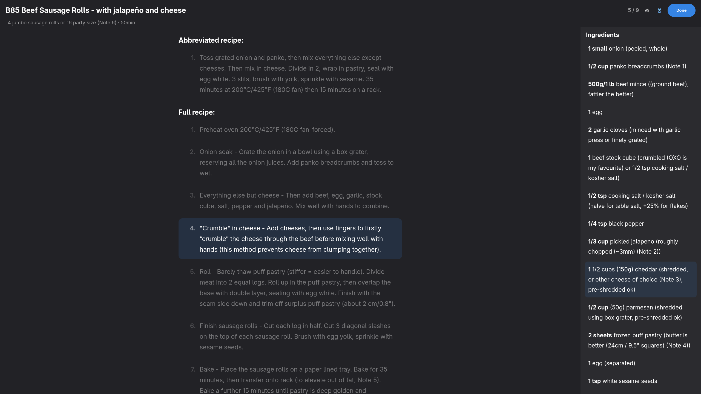
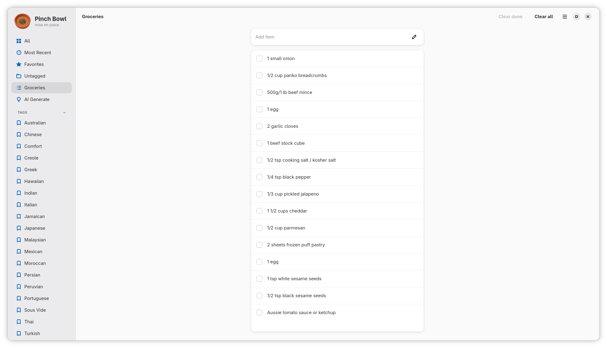
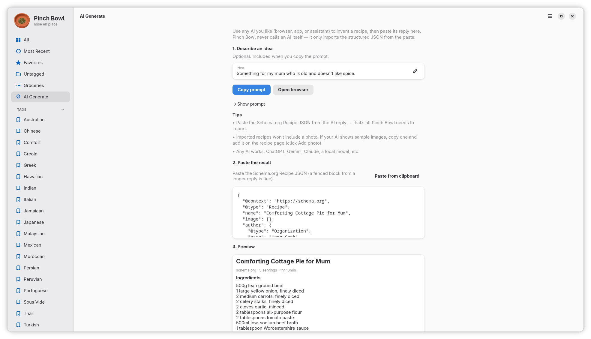
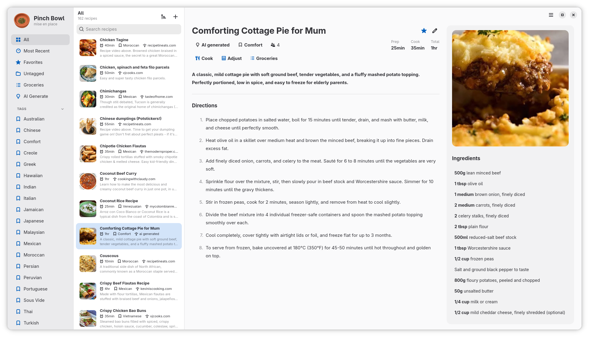
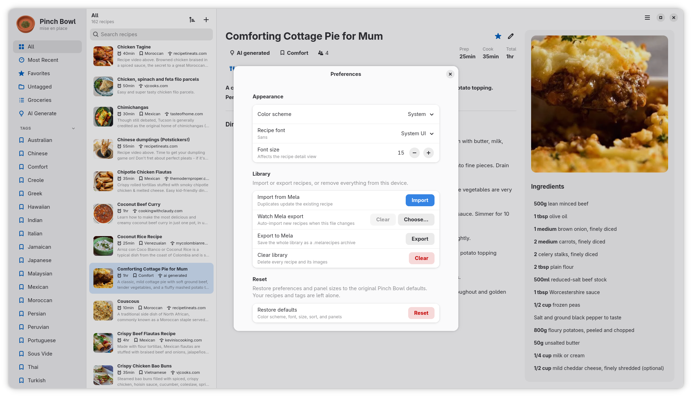

<p align="center">
  
</p>

# Pinch Bowl

A native GNOME recipe app inspired by [Mela](https://mela.recipes). Clean three-pane library, Schema.org / Mela import, guided AI paste import, ad-hoc scaling and unit conversion, distraction-free cook mode, and a groceries checklist.

**App id:** `dev.kakwit.PinchBowl`  
**License:** GPL-3.0-or-later  
**Stack:** Python 3 · GTK 4 · libadwaita

<p align="center">
  <a href="data/screenshots/01-library.png"></a>
  <a href="data/screenshots/02-cook-mode.png"></a>
  <a href="data/screenshots/03-groceries.png"></a>
</p>
<p align="center">
  <a href="data/screenshots/04-ai-generate.png"></a>
  <a href="data/screenshots/05-ai-recipe.png"></a>
  <a href="data/screenshots/06-preferences.png"></a>
</p>

## Run from source

```bash
PYTHONPATH=src python3 -m pinchbowl
```

**Runtime deps:** PyGObject with GTK 4 and libadwaita, plus **GSound** (`gsound` typelib) for cook-timer audio. On Fedora: `python3-gobject gtk4 libadwaita gsound`.

- Recipes DB: `~/.local/share/pinch-bowl/recipes.db`
- Images: `~/.local/share/pinch-bowl/images/`
- Settings: `~/.config/pinch-bowl/settings.json`

## Development

```bash
# Unit tests (no display)
python3 -m venv .venv
.venv/bin/pip install pytest
PYTHONPATH=src .venv/bin/pytest

# Optional meson install (desktop file, icons, pkgdatadir)
meson setup build && meson compile -C build
# meson install -C build   # system/user prefix as configured
```

## Layout

| Pane | Role |
| --- | --- |
| Navigation | All, most recent, favorites, untagged, groceries, AI Generate, tags |
| Recipe list | Thumbnails, title, time, source, snippet |
| Recipe detail | Directions · image + ingredients |

**Groceries** and **AI Generate** in the nav replace the list + detail area with a single page (nav stays). Window size and both sidebar widths are remembered between runs. Preferences cover library color scheme (system / light / dark) and font size. Accent colour follows the desktop.

## Import

- **From URL** (Ctrl+N): fetches the page, reads Schema.org `Recipe` JSON-LD, strips tracking query params, downloads the recipe image when present, upserts by canonical URL.
- **Mela:** `.melarecipe` (JSON) and `.melarecipes` (zip of those), per [Mela’s file format](https://mela.recipes/fileformat/index.html).
- **Recipe file:** import/export a single Schema.org JSON or Melarecipe from the overflow menu.
- **AI Generate** (sidebar): copy a ready-made prompt, open your default browser (no specific site), paste Schema.org Recipe JSON from any AI, preview, then add to the library. Pinch Bowl does not call an AI itself. The prompt used is saved; click **AI generated** on the recipe to view it. Imports have no photo — click **Add photo** on the recipe to paste or choose an image.

## Cook

From the recipe detail **Cook** chip: fullscreen distraction-free mode with larger type, step focus (arrows, click, or scroll), and a side ingredients list. Cook mode has its own light/dark toggle (remembered separately from the library appearance).

**Timers:** the alarm icon opens a popover to add quick durations (or a custom length), list remaining time, and cancel. While timers are running the icon uses the system accent colour. When a timer finishes you get a desktop notification, an in-app alert, and a short alarm sound (up to three plays; stops when you dismiss the alert). Leaving cook mode (Escape or **Done**) warns if any timers are still running — they are cleared on leave (and if the window closes while cooking).

Alarm sound: [Alarm clock beep](https://freesound.org/people/Kesu/sounds/182351/) by Kesu (CC0), also credited in **About**.

## Adjust

From the recipe detail **Adjust** chip: scale servings (½×–4× of the recipe yield) and switch units between **Original**, **Metric**, and **US**. Changes apply only to the open view — nothing is written back to the library.

## Groceries

From the recipe detail **Groceries** chip: pick which ingredients to add (quantities follow the current Adjust scaling/units; all ticked by default). The shared list lives in the recipes database, survives restarts, and is also reachable from **Groceries** in the sidebar — tick items done, type your own lines, clear done, or clear all.

## AI Generate

Sidebar **AI Generate**: describe an optional idea, **Copy prompt** (asks the AI for a readable recipe plus a Schema.org Recipe JSON block), optionally **Open browser**, then paste the JSON and **Add to library**. Works with ChatGPT, Gemini, Claude, local models, etc. — any tool you already use. Source shows as **AI generated** (opens the stored prompt, not a URL).

## Flatpak

The manifest is [`flatpak/dev.kakwit.PinchBowl.yml`](flatpak/dev.kakwit.PinchBowl.yml). It uses the GNOME 51 runtime and bundles GSound for cook-timer audio. CI workflow: [`.github/workflows/flatpak.yml`](.github/workflows/flatpak.yml).

```bash
flatpak-builder --user --install --force-clean build-dir flatpak/dev.kakwit.PinchBowl.yml
flatpak run dev.kakwit.PinchBowl
```

A push to `master` or `main` (and pull requests) builds the Flatpak on GitHub Actions and keeps `dev.kakwit.PinchBowl-x86_64.flatpak` as an artifact. Publishing a downloadable release is optional: push a tag named `v` plus the version (for example `v1.0.20`), or run the Flatpak workflow manually with **Create a GitHub Release…** enabled. That attaches the bundle to the GitHub Release. Install a downloaded bundle with:

```bash
flatpak install --user dev.kakwit.PinchBowl-x86_64.flatpak
```

Flathub (or another remote with the GNOME 51 runtime) must be configured on that computer; the bundle contains the app and Flatpak fetches the runtime.
